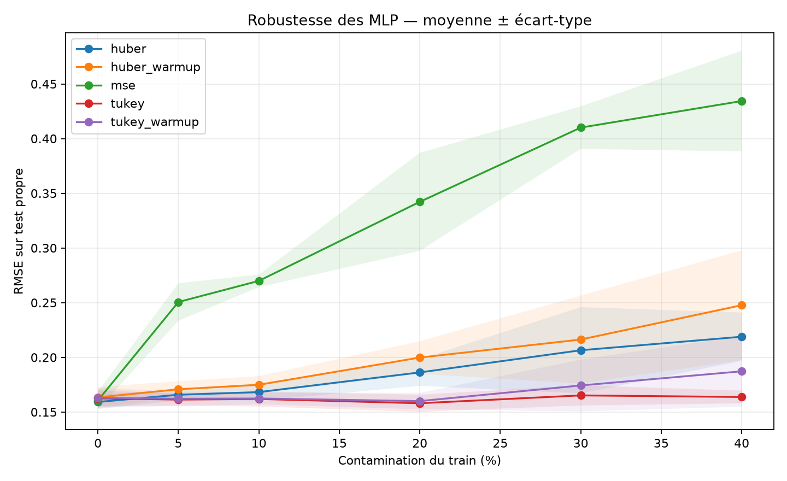
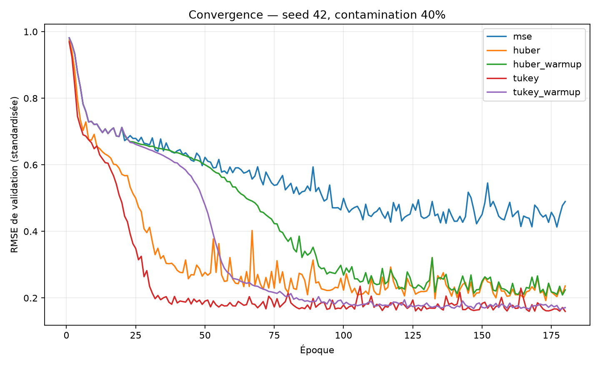
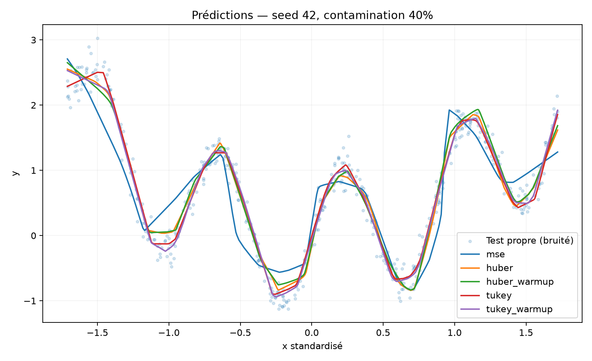

# Robust MLP Regression: MSE vs. Huber vs. Tukey

**How robust loss functions affect neural-network regression under outlier contamination**

In this personal project, I investigate how outliers in training labels affect a multilayer perceptron (MLP). I implemented the experiments in **PyTorch** and compared standard mean squared error (MSE) with two robust alternatives: **Huber** and **Tukey's biweight**.

I wanted to answer two questions: how much does each loss protect prediction accuracy as contamination increases, and does robustness come at the cost of harder optimization?

## Experimental setup

I generate noisy observations from a nonlinear function:

```text
f(x) = sin(2πx) + 0.5x²
```

Only **training labels** are contaminated, at rates of **0%, 5%, 10%, 20%, 30%, and 40%**. Validation and test sets remain clean, so the reported scores measure recovery of the underlying relationship rather than performance on corrupted targets.

I compare five training strategies:

| Strategy | Training loss |
| --- | --- |
| MSE | Mean squared error throughout |
| Huber | Huber loss throughout |
| Huber + warmup | MSE for 20 epochs, then Huber |
| Tukey | Tukey's biweight throughout |
| Tukey + warmup | MSE for 20 epochs, then Tukey |

All five strategies use the **same four-hidden-layer MLP** (64 ReLU units per layer), Adam optimizer, and matched initial weights and datasets within each random seed. Training runs for up to **180 epochs**, with early stopping (patience 45; at least 70 epochs). I select checkpoints using clean validation RMSE and evaluate them on a separate clean test set.

I repeat the experiment for **three seeds (42, 43, 44)** and report test **RMSE, MAE, and R²**. Three seeds provide a useful initial comparison, but not strong statistical evidence.

> **Simulation-specific assumption:** target scaling uses clean training labels *before* contamination. This gives the experiment access to information that would generally be unavailable in real-world datasets. Clean validation data is another favorable experimental assumption.

## Results

The table below shows **mean test RMSE across three seeds** (lower is better).

| Contamination | MSE | Huber | Huber + warmup | Tukey | Tukey + warmup |
| ---: | ---: | ---: | ---: | ---: | ---: |
| 0% | 0.1606 | **0.1592** | 0.1634 | 0.1625 | 0.1631 |
| 5% | 0.2506 | 0.1658 | 0.1708 | **0.1614** | 0.1621 |
| 10% | 0.2700 | 0.1682 | 0.1749 | **0.1619** | 0.1624 |
| 20% | 0.3422 | 0.1862 | 0.1998 | **0.1580** | 0.1600 |
| 30% | 0.4100 | 0.2065 | 0.2163 | **0.1652** | 0.1743 |
| 40% | 0.4343 | 0.2189 | 0.2477 | **0.1637** | 0.1872 |

### Robustness as contamination increases



In my experiments, **MSE deteriorates sharply** as the proportion of corrupted labels increases. Huber is substantially more stable, while **Tukey gives the lowest mean RMSE at every nonzero contamination level**. At 40% contamination, Tukey reaches **0.1637**, compared with **0.4343** for MSE.

### Training dynamics



I also looked at convergence because a robust objective is not automatically easy to optimize. Tukey's loss is non-convex, and large residuals can contribute little or no gradient. This makes initialization and training behavior important when interpreting the final scores.

### Predictions



The prediction plot provides a qualitative check alongside the numerical metrics. It helps show how well each fitted model follows the underlying nonlinear trend when training labels are heavily corrupted.

### What surprised me

I expected an initial MSE warmup to make robust-loss training more reliable. In these runs, however, **warmup did not improve the average RMSE**: the direct Huber and Tukey variants generally performed better than their warmup counterparts. That result is specific to this setup; it does not mean warmup is never useful.

## Installation

Python 3.10+ is recommended.

```bash
python3 -m venv .venv
source .venv/bin/activate
pip install -r requirements.txt
```

On Windows, activate the environment with `.venv\Scripts\activate`.

## Running the experiments

```bash
python run_experiment.py --quick  # Smoke test; not for interpreting results
python run_experiment.py          # Full experiment
python -m pytest -q               # Tests
```

Settings are defined in `configs/default.yaml`. The code supports CPU, CUDA, and Apple Silicon MPS when available.

The full run generates figures and detailed CSV results locally in `outputs/`. **Only the three PNG figures are tracked in this repository**; generated CSV files and the run-specific output configuration are intentionally excluded from Git.

## Repository structure

```text
configs/default.yaml    Experiment settings
src/data.py             Synthetic data and label contamination
src/models.py           MLP architecture
src/losses.py           MSE, Huber, and Tukey losses
src/train.py            Training and checkpoint selection
src/plots.py            Visualization
run_experiment.py       Experiment entry point
tests/test_project.py   Basic tests
outputs/*.png           Published experimental figures
```

## Limitations and next steps

This is a **controlled synthetic experiment**, not a claim that Tukey will outperform other losses on every dataset. In particular:

- Both checkpoint selection and final evaluation use clean labels.
- Target scaling relies on clean pre-contamination training labels.
- Three random seeds are not enough to establish statistical significance.
- Tukey's non-convex objective can be sensitive to initialization and its tuning constant.
- Training uses **backpropagation with Adam**, not iteratively reweighted least squares (IRLS).

Next, I would like to tune the Huber and Tukey thresholds, test asymmetric and feature-dependent contamination, run more seeds, and evaluate the approach on a real regression dataset.
